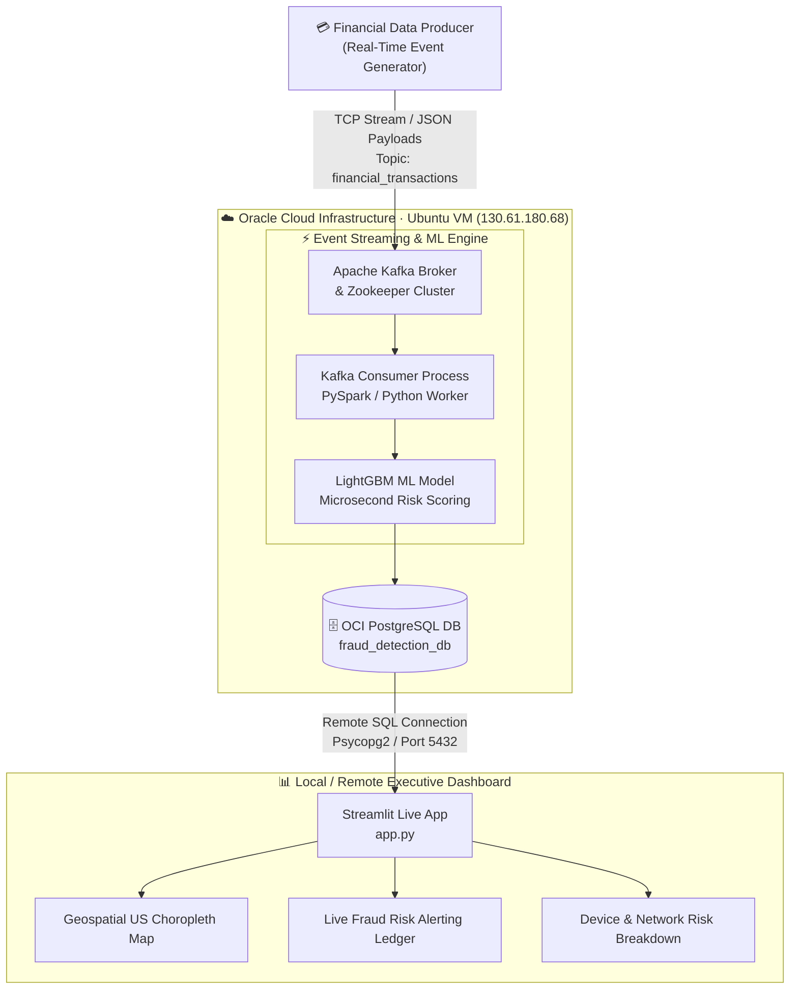
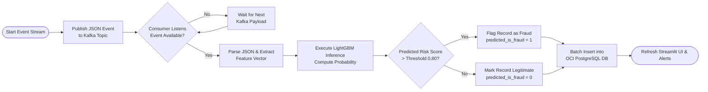
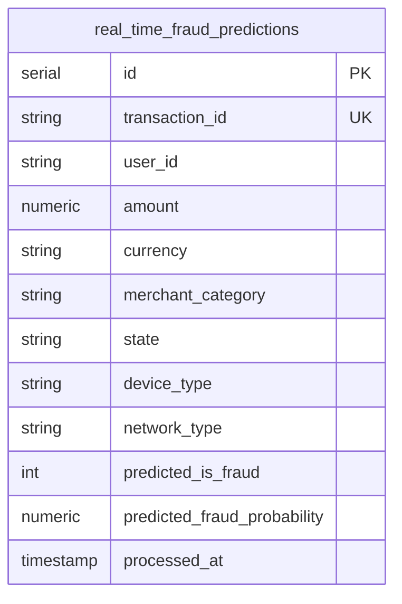

<div align="left">

# 💳 End-to-End Real-Time Credit Card Fraud Detection Pipeline

### Enterprise-Grade Financial Transaction Monitoring & Streaming Analytics Platform

*Sub-millisecond ML Risk Scoring & Ingestion: Kafka → LightGBM → OCI PostgreSQL → Streamlit*


[Overview](#-overview) •
[Architecture](#-system-architecture) •
[Data Model](#-relational-database-schema) •
[Dashboard](#-streamlit-live-dashboard--executive-ui) •
[Insights](#-key-analytical-findings) •
[Quick Start](#-quick-start) •
[Roadmap](#-roadmap)

</div>

---

## 📑 Table of Contents

* [Overview](#-overview)
* [Executive Summary & Key Metrics](#-executive-summary--key-metrics)
* [System Architecture](#-system-architecture)
* [Pipeline Logic (ETL)](#-pipeline-logic-etl)
* [Key Engineering Features](#-key-engineering-features)
* [Relational Database Schema](#-relational-database-schema)
* [Streamlit Live Dashboard & Executive UI](#-streamlit-live-dashboard--executive-ui)
* [Key Analytical Findings](#-key-analytical-findings)
* [Tech Stack](#-tech-stack)
* [Quick Start](#-quick-start)
* [Configuration](#-configuration)
* [Repository Structure](#-repository-structure)
* [Engineering Challenges & Solutions](#-engineering-challenges--solutions)
* [Roadmap](#-roadmap)
* [Troubleshooting](#-troubleshooting)
* [Security](#-security)
* [Author](#-author)

---

## 🎯 Overview

<!-- Live Streaming Demo GIF -->
<div align="center">
  
</div>

<br/>

An enterprise-grade, real-time financial stream processing and fraud detection system that **streams transaction events, executes low-latency machine learning inference, persists enriched predictions to cloud storage, and visualizes live risk telemetry**:

| Data Layer | Description / Purpose |
| --- | --- |
| **Kafka Producer** | Continuous JSON stream simulating high-frequency credit card transaction events across 50 US states. |
| **LightGBM Inference Engine** | Microsecond-level ML scoring model calculating probabilistic fraud risk (`0.00` to `1.00`). |
| **OCI PostgreSQL DB** | Cloud relational database instance (`130.61.180.68:5432`) serving as persistent audit storage. |
| **Streamlit UI** | Executive live monitoring dashboard featuring geospatial risk maps and automated alert thresholds. |

An event-driven **Apache Kafka** pub-sub cluster runs on an **Oracle Cloud Infrastructure (OCI)** Ubuntu VM, streams transaction payloads, evaluates real-time risk via **LightGBM**, persists enriched records into **PostgreSQL**, and feeds a remote **Streamlit** visualization suite.

---

## 📌 Executive Summary & Key Metrics

The pipeline continuously monitors financial operations, isolating high-risk transaction attempts, flagging network anomalies (e.g., TOR exit nodes), and tracking blocked financial exposure in real time.

| Metric | Value |
| --- | --- |
| 💳 Total Ingested Transactions | **44,532 records** |
| 🛡️ Identified & Blocked Fraud Cases | **4,374 transactions** |
| 💵 Total Blocked Fraud Exposure | **$10,072,232.82** |
| 🚨 Overall Pipeline Fraud Rate | **9.82%** |
| 🌐 TOR Network Fraud Risk Rate | **53.49% – 56.83%** |
| ⚡ ML Inference Latency | **< 2 milliseconds** |

---

## 🏗️ System Architecture



---

## ⚙️ Pipeline Logic (ETL)



---

## 🌟 Key Engineering Features

### 🔒 Microsecond ML Risk Engine

Integrates a pre-trained LightGBM classification engine inside the Kafka consumer loop, delivering instantaneous sub-millisecond fraud scoring without network request overhead.

### 🔄 Non-Blocking Background Daemon

Engineered on an OCI Ubuntu Compute instance using `nohup` background tasks to ensure 24/7 continuous ingestion, model evaluation, and DB storage without user intervention.

### ⚡ Optimized Database Indexing

Employs targeted PostgreSQL indexes on high-cardinality search fields (`state`, `merchant_category`, `predicted_is_fraud`) to maintain sub-second query performance over 44,000+ records.

```sql
CREATE INDEX idx_fraud_predictions_state
ON real_time_fraud_predictions(state);

CREATE INDEX idx_fraud_predictions_is_fraud
ON real_time_fraud_predictions(predicted_is_fraud);
```

### 📐 Multi-Node Cloud Architecture

Decouples local presentation (Streamlit) from cloud infrastructure (Kafka & PostgreSQL on OCI), providing security and mirroring enterprise production workflows.

---

## 🗄️ Relational Database Schema

The OCI PostgreSQL database (`fraud_detection_db`) uses a streamlined relational structure for high-write streaming ingestion and rapid analytical aggregation.



| Column | Data Type | Constraint / Default | Description |
| --- | --- | --- | --- |
| `id` | `SERIAL` | `PRIMARY KEY` | Auto-incrementing row identifier |
| `transaction_id` | `VARCHAR(50)` | `UNIQUE NOT NULL` | Unique financial transaction reference ID |
| `user_id` | `VARCHAR(50)` | `NOT NULL` | Associated customer account identifier |
| `amount` | `NUMERIC(10,2)` | `NOT NULL` | Transaction monetary value (USD) |
| `currency` | `VARCHAR(10)` | `DEFAULT 'USD'` | Transaction ISO currency code |
| `merchant_category` | `VARCHAR(100)` | `NOT NULL` | Industry category of merchant |
| `state` | `VARCHAR(10)` | `NOT NULL` | US state 2-letter location code |
| `device_type` | `VARCHAR(50)` | `NOT NULL` | Terminal or device medium used |
| `network_type` | `VARCHAR(50)` | `NOT NULL` | IP routing origin (Residential, TOR, VPN) |
| `predicted_is_fraud` | `INT` | `CHECK (0 OR 1)` | Binary LightGBM classification flag |
| `predicted_fraud_probability` | `NUMERIC(6,4)` | `NOT NULL` | Calculated ML risk confidence score |
| `processed_at` | `TIMESTAMP` | `DEFAULT CURRENT_TIMESTAMP` | Ingestion timestamp |

---

## 📊 Streamlit Live Dashboard & Executive UI

Here is the real-time monitoring interface tracking live transaction streams and Machine Learning fraud alerts:

### 📄 Executive Risk Monitoring & Analytics Interface


*Figure 1: Executive KPI strip, US geospatial fraud hotspots, network risk vectors, and top merchant categories.*

<br/>

* **Top KPI Cards:** Ingested Volume (**44,532**), Blocked Fraud Events (**4,374**), Total Prevented Loss (**$10.07M**), Peak Risk Sector (**Crypto & Gaming**).
* **Geospatial US Heatmap:** Live Plotly Choropleth displaying transaction concentration and regional risk spikes across all 50 states.
* **Risk Matrix Visuals:** Cross-tabulation of Device Medium vs. IP Network Origin isolating anonymized TOR exit nodes.
* **Real-Time Alert Ledger:** High-risk audit table filtering transactions with `predicted_fraud_probability > 0.80`.

### 🚨 Real-Time High-Risk Audit Ledger


*Figure 2: Real-time transaction audit log with dark-red threshold highlighting for high-probability fraud alerts.*

<br/>

```python
import psycopg2
import pandas as pd

def fetch_live_fraud_data():
    conn = psycopg2.connect(
        dbname="fraud_detection_db",
        user="postgres",
        password="your_secure_password",
        host="130.61.180.68",
        port="5432"
    )
    query = """
    SELECT
        state,
        COUNT(*) AS total_txns,
        COUNT(*) FILTER (WHERE predicted_is_fraud = 1) AS fraud_cases,
        ROUND(SUM(CASE WHEN predicted_is_fraud = 1 THEN amount ELSE 0 END)::numeric, 2) AS blocked_usd
    FROM real_time_fraud_predictions
    GROUP BY state
    ORDER BY fraud_cases DESC;
    """
    df = pd.read_sql(query, conn)
    conn.close()
    return df
```

---

## 🔍 Key Analytical Findings

> Insights derived from SQL queries in [`sql/analytics_queries.sql`](sql/analytics_queries.sql).

| # | Finding | Detail |
| --- | --- | --- |
| 1 | **TOR Exit Node Vulnerability** | **TOR Exit Node** network traffic exhibits a **>50% fraud rate** regardless of device type (ATM: **56.83%**, Web: **54.51%**, Mobile: **54.13%**). |
| 2 | **High-Risk Industry Sectors** | **Crypto & Gaming Assets** produced the highest fraud volume (**1,288 cases**, `0.2848` avg risk score), followed by **E-Commerce** (**677 cases**). |
| 3 | **Financial Severity Outliers** | **Luxury & Jewelry** fraud transactions average **$4,872.14 per incident**, posing the highest financial exposure per single event. |
| 4 | **Geographic Loss Distribution** | **Ohio (OH)** recorded the highest total fraud occurrences (**108 cases**, **$258.1k** blocked), while **Hawaii (HI)** had the highest total blocked exposure (**$273.6k**). |

```sql
SELECT
    device_type,
    network_type,
    COUNT(*) AS total_txns,
    COUNT(*) FILTER (WHERE predicted_is_fraud = 1) AS fraud_cases,
    ROUND((COUNT(*) FILTER (WHERE predicted_is_fraud = 1)::numeric / COUNT(*)) * 100, 2) AS risk_pct
FROM real_time_fraud_predictions
GROUP BY device_type, network_type
ORDER BY risk_pct DESC;
```

---

## 🧰 Tech Stack

| Layer | Technology |
| --- | --- |
| **Data Streaming** | Apache Kafka, Zookeeper |
| **Inference Engine** | Python 3.10, LightGBM, Scikit-Learn |
| **Infrastructure** | Oracle Cloud Infrastructure (Ubuntu Compute VM) |
| **Data Processing** | Pandas, NumPy |
| **Database Storage** | OCI PostgreSQL (Indexed Schema) |
| **Analytics & SQL** | PostgreSQL Standard SQL |
| **BI & Visualization** | Streamlit, Plotly Express |
| **Database Client** | pgAdmin 4, Psycopg2 |

---

## 🚀 Quick Start

### Prerequisites

* 🐍 Python 3.10+
* 🔑 SSH Private Key for OCI Server access
* 🗄️ pgAdmin 4 or DBeaver (optional for database exploration)

### Installation

**1️⃣ Clone the repository**

```bash
git clone https://github.com/NihatRzaguluzada/kafka-fraud-detection.git
cd kafka-fraud-detection
```

**2️⃣ Setup Virtual Environment**

```bash
# Windows
python -m venv venv
venv\Scripts\activate

# macOS / Linux
python3 -m venv venv
source venv/bin/activate
```

**3️⃣ Install Dependencies**

```bash
pip install -r requirements.txt
```

**4️⃣ Initialize Database Schema**

Execute the DDL script on your PostgreSQL instance:

```bash
psql -h 130.61.180.68 -U postgres -d fraud_detection_db -f sql/schema.sql
```

**5️⃣ Launch Executive Streamlit Dashboard**

```bash
streamlit run src/app.py
```

---

## 🔧 Configuration

| Item | Location | Description |
| --- | --- | --- |
| DB Config | `config/db_config.py` | Connection details for OCI PostgreSQL instance |
| Kafka Broker | `src/producer.py` | `130.61.180.68:9092` |
| LightGBM Model | `models/lightgbm_fraud_model.pkl` | Binary classification model binary |
| Streamlit App | `src/app.py` | Dashboard application code |

---

## 📁 Repository Structure

```text
kafka-fraud-detection/
├── .gitignore                      # Git exclusion rules (venv, logs, credentials)
├── README.md                       # Comprehensive architecture & project docs
├── requirements.txt                # Python dependency manifests
│
├── config/
│   └── db_config.py                # Database connection factory & environment management
│
├── models/
│   └── lightgbm_fraud_model.pkl    # Pre-trained LightGBM classification artifact
│
├── src/
│   ├── producer.py                 # Real-time transaction generator sending events to Kafka
│   ├── consumer.py                 # Kafka consumer executing ML predictions & DB persistence
│   └── app.py                      # Multi-metric live Streamlit monitoring dashboard
│
└── sql/
    ├── schema.sql                  # PostgreSQL table initialization DDL & index schemas
    └── analytics_queries.sql       # Enterprise SQL analytics for risk intelligence
```

---

## 🧩 Engineering Challenges & Solutions

| Challenge | Solution |
| --- | --- |
| Remote database latency slowing down Kafka stream ingestion | Implemented batch insertion and connection pooling via `psycopg2` |
| Case-sensitivity mismatches in PostgreSQL SQL aggregations | Standardized column names in lower_case and applied explicit `FILTER` clauses |
| Terminal process termination upon SSH exit | Deployed services via `nohup python script.py > log.log 2>&1 &` background daemons |
| Anomaly skew in network telemetry visualization | Filtered proxy and TOR network flags into discrete categorical risk categories |
| Data consistency across local and cloud environments | Created centralized `db_config.py` module with environment variable support |

---

## 🗺️ Roadmap

* [x] Real-time transaction simulation via Apache Kafka producer
* [x] Sub-millisecond ML risk scoring with LightGBM
* [x] OCI Cloud Ubuntu PostgreSQL database hosting
* [x] Streamlit executive dashboard with live Plotly map
* [x] Enterprise analytical SQL queries
* [ ] Automated Slack / Telegram instant alerts for high-value fraud (> $5,000)
* [ ] Docker Compose orchestration for full local environment emulation
* [ ] PySpark Structured Streaming migration for horizontal scaling
* [ ] GitHub Actions CI/CD workflow for automated unit testing

---

## 🛠️ Troubleshooting

Verify network connectivity and ensure OCI Security List permits ingress traffic on port 5432:

```bash
# Test port reachability from Windows PowerShell
Test-NetConnection -ComputerName 130.61.180.68 -Port 5432
```

Connect via SSH and verify running background processes:

```bash
ps aux | grep python
# Restart consumer daemon if inactive
nohup python consumer.py > consumer.log 2>&1 &
```

---

## 🔒 Security

Protect cloud credentials, database passwords, and private SSH keys by adding the following rules to `.gitignore`:

```text
# Credentials & Private Keys
*.key
*.pem
.env
config/db_credentials.json

# Environment & Logs
venv/
__pycache__/
*.log

# IDE Files
.vscode/
.idea/
```

---

## 👤 Author

**Nihat Rzaguluzada | Data Analytics & Engineering Specialist**

Developed as an enterprise-grade **Data Engineering & Financial Analytics portfolio project** demonstrating proficiency in Event Streaming (Kafka), Machine Learning Deployment (LightGBM), Cloud Database Administration (OCI PostgreSQL), SQL Analytics, and Dashboard Engineering (Streamlit).
