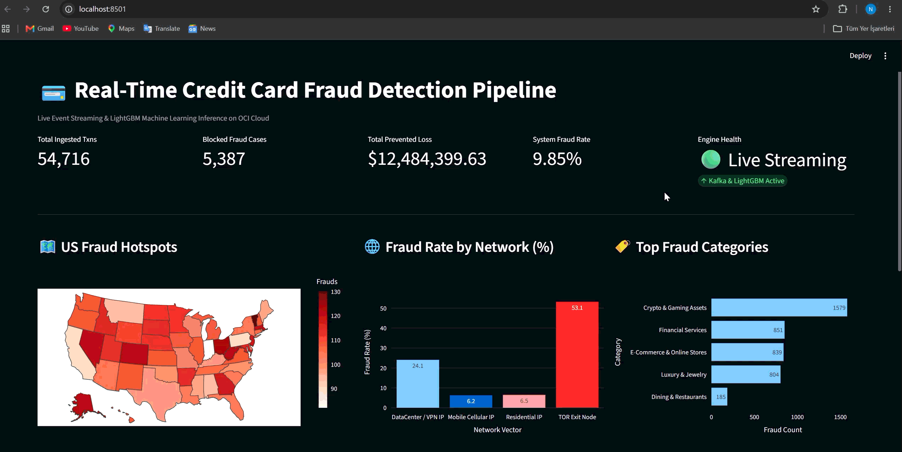
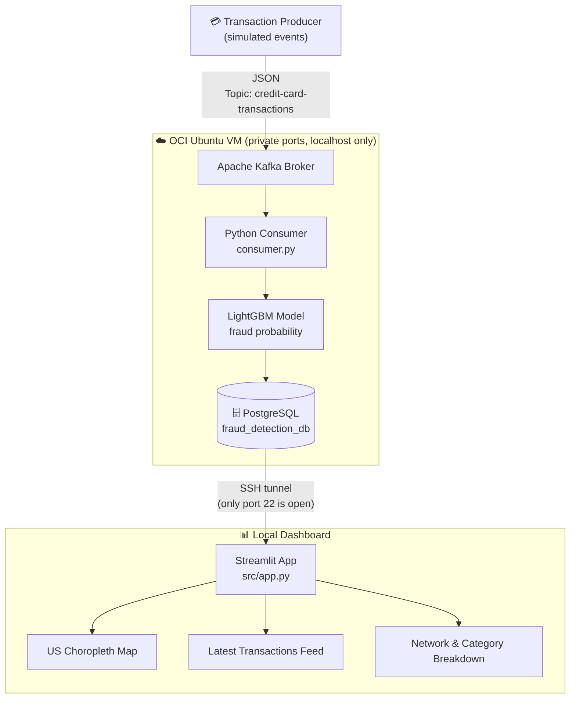
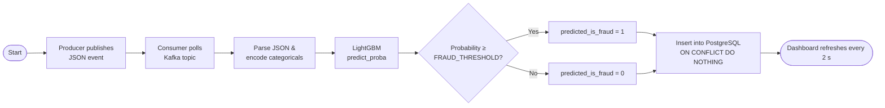
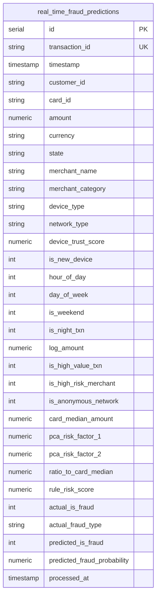
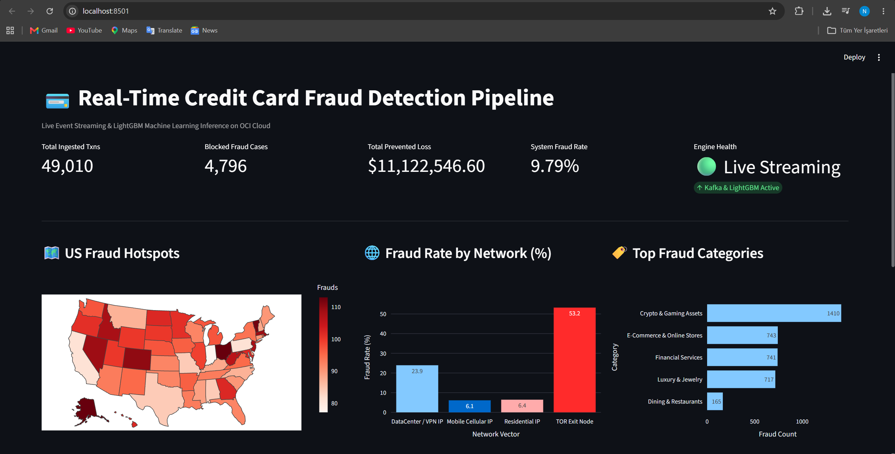
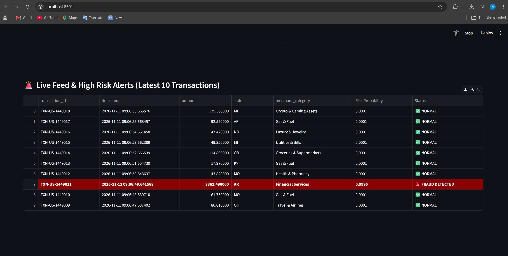

<div align="left">

# 💳 Real-Time Credit Card Fraud Detection Pipeline

### Kafka → LightGBM → PostgreSQL → Streamlit

*A streaming fraud-scoring portfolio project built on simulated card transactions and deployed on Oracle Cloud Infrastructure (OCI).*


[Overview](#-overview) •
[Architecture](#-system-architecture) •
[Data Model](#-relational-database-schema) •
[Dashboard](#-streamlit-live-dashboard) •
[Insights](#-key-analytical-findings) •
[Quick Start](#-quick-start) •
[Security](#-security) •
[Roadmap](#-roadmap)

</div>

---

## 📑 Table of Contents

* [Overview](#-overview)
* [Key Metrics](#-key-metrics-demo-snapshot)
* [System Architecture](#-system-architecture)
* [Pipeline Logic](#-pipeline-logic)
* [Key Engineering Features](#-key-engineering-features)
* [Relational Database Schema](#-relational-database-schema)
* [Streamlit Live Dashboard](#-streamlit-live-dashboard)
* [Key Analytical Findings](#-key-analytical-findings)
* [Tech Stack](#-tech-stack)
* [Quick Start](#-quick-start)
* [Configuration](#-configuration)
* [Repository Structure](#-repository-structure)
* [Engineering Challenges & Solutions](#-engineering-challenges--solutions)
* [Security](#-security)
* [Roadmap](#-roadmap)
* [Troubleshooting](#-troubleshooting)
* [Author](#-author)

---

## 🎯 Overview

<div align="center">
  
</div>

<br/>

A real-time stream-processing system that **ingests transaction events, scores them with a LightGBM model, stores the enriched predictions in PostgreSQL, and visualizes live risk telemetry**.

> ⚠️ **Data disclaimer:** all transactions are **synthetic** and produced by a simulator (`src/producer.py`). The `predicted_*` columns are model output; the simulator's ground-truth labels are stored separately as `actual_is_fraud` / `actual_fraud_type`. Findings below describe the simulated data and the model, not real-world fraud behavior.

| Component | Description |
| --- | --- |
| **Kafka Producer** | Continuous JSON stream simulating credit card transactions across 50 US states. |
| **LightGBM Consumer** | Kafka consumer that encodes features, scores each event (`0.00`–`1.00` fraud probability) and writes the result to PostgreSQL. |
| **PostgreSQL** | Persistent storage for predictions and ground-truth labels (idempotent writes via `ON CONFLICT (transaction_id) DO NOTHING`). |
| **Streamlit UI** | Live dashboard with a US fraud map, network/merchant breakdowns and a latest-transactions feed. |

Kafka, the consumer and PostgreSQL run on a single OCI Ubuntu VM. The Streamlit dashboard connects to the database **through an SSH tunnel** (see [Quick Start](#-quick-start)); no database or broker port is exposed to the internet.

---

## 📌 Key Metrics (demo snapshot)

Values from one demo run on simulated data. "Flagged" means `predicted_is_fraud = 1`.

| Metric | Value |
| --- | --- |
| 💳 Total ingested transactions | **44,532** |
| 🚩 Flagged as fraud | **4,374** |
| 💵 Total flagged amount | **$10,072,232.82** |
| 📈 Flagged rate | **9.82%** |
| 🌐 Flagged rate on TOR traffic | **53.49% – 56.83%** |
| ⚡ Inference latency | _Not yet benchmarked (see [Roadmap](#-roadmap))_ |

---

## 🏗️ System Architecture



---

## ⚙️ Pipeline Logic



The decision threshold is configurable through the `FRAUD_THRESHOLD` environment variable (default `0.80`).

---

## 🌟 Key Engineering Features

### 🤖 In-Process ML Scoring

The pre-trained LightGBM model is loaded once and runs inside the Kafka consumer loop, so scoring needs no network call to a separate model service.

### 🔁 Idempotent Writes

`transaction_id` is `UNIQUE` and inserts use `ON CONFLICT (transaction_id) DO NOTHING`, so re-reading a message from Kafka never creates duplicate rows.

### ⚡ Targeted Indexes

Indexes on frequently filtered columns keep dashboard aggregations fast on the current data volume (tens of thousands of rows):

```sql
CREATE INDEX idx_fraud_predictions_state
ON real_time_fraud_predictions(state);

CREATE INDEX idx_fraud_predictions_is_fraud
ON real_time_fraud_predictions(predicted_is_fraud);
```

### 🔒 Reduced Network Exposure

Kafka and PostgreSQL listen on `localhost` on the VM. The dashboard reaches the database through an SSH tunnel with a **read-only** database role.

---

## 🗄️ Relational Database Schema

Table: `real_time_fraud_predictions` in `fraud_detection_db`. The authoritative DDL (exact types, constraints, indexes) is in [`sql/schema.sql`](sql/schema.sql).



| Column group | Columns | Description |
| --- | --- | --- |
| **Identity** | `id`, `transaction_id` (unique), `customer_id`, `card_id` | Row key, transaction reference, customer and card identifiers |
| **Transaction** | `timestamp`, `amount`, `currency`, `state`, `merchant_name`, `merchant_category` | Core event attributes |
| **Device / network** | `device_type`, `network_type`, `device_trust_score`, `is_new_device`, `is_anonymous_network` | Channel and connection context (e.g. Residential, VPN, TOR) |
| **Engineered features** | `hour_of_day`, `day_of_week`, `is_weekend`, `is_night_txn`, `log_amount`, `is_high_value_txn`, `is_high_risk_merchant`, `card_median_amount`, `ratio_to_card_median`, `pca_risk_factor_1/2`, `rule_risk_score` | Features produced by the generator / feature pipeline |
| **Ground truth** | `actual_is_fraud`, `actual_fraud_type` | Simulator labels, kept for model evaluation |
| **Model output** | `predicted_is_fraud`, `predicted_fraud_probability`, `processed_at` | Prediction, probability and ingestion time |

---

## 📊 Streamlit Live Dashboard

[`src/app.py`](src/app.py) auto-refreshes every 2 seconds and shows:

* **5 KPI cards:** total ingested transactions, flagged fraud cases, total flagged amount, flagged rate, and an engine status indicator.
* **US fraud map:** Plotly choropleth of flagged transactions per state.
* **Flagged rate by network type:** bar chart (e.g. TOR vs. Residential).
* **Top 5 fraud categories:** horizontal bar chart of flagged transactions per merchant category.
* **Live feed:** the 10 most recent transactions, with flagged rows highlighted in dark red.



*Figure 1: KPI strip, US fraud map, network risk and top merchant categories.*



*Figure 2: Latest-transactions feed with flagged rows highlighted.*

Connection settings come from environment variables (never hard-coded), and queries aggregate in SQL instead of loading the whole table:

```python
import os
import pandas as pd
import streamlit as st
from sqlalchemy import create_engine
from sqlalchemy.engine import URL


@st.cache_resource
def get_engine():
    url = URL.create(
        "postgresql+psycopg2",
        username=os.environ["DB_USER"],
        password=os.environ["DB_PASSWORD"],
        host=os.environ.get("DB_HOST", "localhost"),
        port=int(os.environ.get("DB_PORT", "5432")),
        database=os.environ["DB_NAME"],
    )
    return create_engine(url, pool_size=3, pool_pre_ping=True)


@st.cache_data(ttl=2)
def fetch_state_summary() -> pd.DataFrame:
    query = """
    SELECT
        state,
        COUNT(*) AS total_txns,
        COUNT(*) FILTER (WHERE predicted_is_fraud = 1) AS fraud_cases,
        ROUND(COALESCE(SUM(amount) FILTER (WHERE predicted_is_fraud = 1), 0)::numeric, 2) AS flagged_usd
    FROM real_time_fraud_predictions
    GROUP BY state
    ORDER BY fraud_cases DESC;
    """
    return pd.read_sql(query, get_engine())
```

---

## 🔍 Key Analytical Findings

> Derived from [`sql/analytics_queries.sql`](sql/analytics_queries.sql) on **simulated data**; "fraud" here means `predicted_is_fraud = 1`.

| # | Finding | Detail |
| --- | --- | --- |
| 1 | **TOR traffic is flagged most often** | Flagged rate on TOR traffic exceeds 50% across device types (ATM: **56.83%**, Web: **54.51%**, Mobile: **54.13%**). |
| 2 | **Crypto & Gaming leads in volume** | Highest number of flagged transactions (**1,288**, avg probability `0.2848`), followed by E-Commerce (**677**). |
| 3 | **Luxury & Jewelry has the largest tickets** | Average flagged amount of **$4,872.14** per transaction. |
| 4 | **Geographic distribution** | **Ohio (OH)** has the most flagged transactions (**108**, **$258.1k**); **Hawaii (HI)** has the highest flagged amount (**$273.6k**). |

```sql
SELECT
    device_type,
    network_type,
    COUNT(*) AS total_txns,
    COUNT(*) FILTER (WHERE predicted_is_fraud = 1) AS fraud_cases,
    ROUND((COUNT(*) FILTER (WHERE predicted_is_fraud = 1)::numeric / COUNT(*)) * 100, 2) AS risk_pct
FROM real_time_fraud_predictions
GROUP BY device_type, network_type
ORDER BY risk_pct DESC;
```

---

## 🧰 Tech Stack

| Layer | Technology |
| --- | --- |
| **Streaming** | Apache Kafka (`kafka-python`) |
| **ML inference** | Python 3.10, LightGBM, Scikit-Learn, joblib |
| **Infrastructure** | Oracle Cloud Infrastructure (Ubuntu Compute VM) |
| **Data processing** | Pandas, NumPy |
| **Storage** | PostgreSQL (indexed schema) |
| **Visualization** | Streamlit, Plotly Express |
| **DB clients** | psycopg2, SQLAlchemy, pgAdmin 4 |

---

## 🚀 Quick Start

### Prerequisites

* 🐍 Python 3.10+
* 🔑 SSH private key for the OCI VM
* 🗄️ A PostgreSQL instance and a Kafka broker (on the VM or local)

### 1️⃣ Clone and install

```bash
git clone https://github.com/nihatrza/kafka-fraud-detection.git
cd kafka-fraud-detection

# Windows
python -m venv venv
venv\Scripts\activate

# macOS / Linux
python3 -m venv venv
source venv/bin/activate

pip install -r requirements.txt
```

### 2️⃣ Configure environment

```bash
cp .env.example .env      # then edit .env; never commit it
```

See [Configuration](#-configuration) for all variables.

### 3️⃣ Initialize the database (on the VM)

```bash
psql -h localhost -U postgres -d fraud_detection_db -f sql/schema.sql
```

### 4️⃣ Run the pipeline (on the VM)

```bash
python src/consumer.py     # scores events and writes to PostgreSQL
python src/producer.py     # generates simulated transactions
```

Run the producer on the VM as well, so the Kafka port never has to be exposed.

### 5️⃣ Open an SSH tunnel and start the dashboard (on your machine)

```bash
# Forward local port 15432 to PostgreSQL on the VM
ssh -N -L 15432:localhost:5432 -i <path-to-private-key> ubuntu@<OCI_VM_PUBLIC_IP>
```

In a second terminal, set `DB_HOST=localhost` and `DB_PORT=15432` in `.env` and run:

```bash
streamlit run src/app.py
```

---

## 🔧 Configuration

All settings are read from environment variables. Copy `.env.example` to `.env` (ignored by git).

| Variable | Example | Used by | Description |
| --- | --- | --- | --- |
| `DB_HOST` | `localhost` | consumer, app | Database host (`localhost` on the VM or through the SSH tunnel) |
| `DB_PORT` | `5432` / `15432` | consumer, app | `15432` when using the local end of the SSH tunnel |
| `DB_NAME` | `fraud_detection_db` | consumer, app | Database name |
| `DB_USER` | `dashboard_ro` | app | Use a **read-only** role for the dashboard |
| `DB_PASSWORD` | _(secret)_ | consumer, app | Never commit this value |
| `KAFKA_BOOTSTRAP_SERVERS` | `localhost:9092` | producer, consumer | Broker address |
| `KAFKA_TOPIC` | `credit-card-transactions` | producer, consumer | Topic name |
| `MODEL_PATH` | `models/best_fraud_model.pkl` | consumer | Model artifact (dict with `model`, `label_encoders`, `feature_names`, `model_name`) |
| `FRAUD_THRESHOLD` | `0.80` | consumer | Probability at or above which a transaction is flagged |

---

## 📁 Repository Structure

```text
kafka-fraud-detection/
├── .env.example                    # Template for environment variables (no secrets)
├── .gitignore                      # Excludes venv, logs, credentials, .env
├── LICENSE                         # MIT
├── README.md
├── requirements.txt
│
├── config/
│   └── db_config.py                # Reads DB settings from environment variables
│
├── docs/                           # Demo GIF and dashboard screenshots
│
├── models/
│   └── best_fraud_model.pkl        # Trained LightGBM artifact (model + encoders + feature names)
│
├── src/
│   ├── producer.py                 # Simulated transaction generator → Kafka
│   ├── consumer.py                 # Kafka consumer: ML scoring + PostgreSQL persistence
│   └── app.py                      # Streamlit monitoring dashboard
│
└── sql/
    ├── schema.sql                  # Table DDL and indexes
    └── analytics_queries.sql       # Analytical SQL queries
```

---

## 🧩 Engineering Challenges & Solutions

| Challenge | Solution |
| --- | --- |
| Remote database latency could slow down ingestion | Consumer runs on the same VM as PostgreSQL (`localhost`); only the dashboard connects remotely. Batch inserts are on the [Roadmap](#-roadmap). |
| Duplicate rows when messages are re-read | Unique `transaction_id` plus `ON CONFLICT DO NOTHING` |
| Case-sensitivity mismatches in PostgreSQL aggregations | Lower-case column names and explicit `FILTER` clauses |
| Processes dying when the SSH session closes | Started with `nohup ... &`; a `systemd` service is the planned replacement |
| Exposing the database to the dashboard safely | SSH tunnel plus a read-only database role instead of an open port 5432 |
| Skewed network telemetry in charts | Network flags grouped into discrete categories (Residential, VPN, TOR, ...) |

---

## 🔒 Security

This repository is a portfolio project, but it follows basic hardening rules:

**Secrets and addresses**

* No credentials, hostnames or IP addresses are stored in code or docs. Everything comes from environment variables; `.env` is git-ignored and only `.env.example` is committed.
* If a password or server address was ever committed, **rotate it immediately** (change the DB password, consider a new reserved public IP) and remove it from history with [`git filter-repo`](https://github.com/newren/git-filter-repo) or BFG. Deleting the line in a new commit is not enough.

**Network**

* In the OCI **Security List / NSG**, allow ingress only for **TCP 22 from your own IP**. Do not open `5432` (PostgreSQL), `9092` (Kafka) or `2181` (Zookeeper) to `0.0.0.0/0`.
* Bind Kafka and PostgreSQL to `localhost` (`listeners=PLAINTEXT://localhost:9092`, `listen_addresses = 'localhost'`).
* Reach the database from your laptop through an SSH tunnel (see [Quick Start](#-quick-start)).

**Database**

* Use a dedicated least-privilege role for the dashboard:

```sql
CREATE ROLE dashboard_ro LOGIN PASSWORD '<strong-password>';
GRANT CONNECT ON DATABASE fraud_detection_db TO dashboard_ro;
GRANT USAGE ON SCHEMA public TO dashboard_ro;
GRANT SELECT ON real_time_fraud_predictions TO dashboard_ro;
```

**Model artifacts**

* `joblib`/`pickle` files can execute arbitrary code when loaded. Only load model files you trained yourself or fully trust.

**Recommended `.gitignore` entries**

```text
# Credentials & private keys
*.key
*.pem
.env
.env.*
!.env.example

# Environment & logs
venv/
__pycache__/
*.log

# IDE files
.vscode/
.idea/
```

---

## 🗺️ Roadmap

- [x] Simulated transaction stream via a Kafka producer
- [x] LightGBM scoring inside the Kafka consumer
- [x] PostgreSQL storage on an OCI VM
- [x] Streamlit dashboard with live Plotly map
- [x] Analytical SQL queries
- [ ] Benchmark inference latency (p50 / p99) and publish the numbers
- [ ] Report model quality using `actual_is_fraud` (precision, recall, PR-AUC)
- [ ] Batch inserts, manual offset commits and a dead-letter topic in the consumer
- [ ] Use `FRAUD_THRESHOLD`, `MODEL_PATH` and `config/db_config.py` consistently in all scripts
- [ ] `systemd` services instead of `nohup`
- [ ] Docker Compose for a one-command local environment
- [ ] Slack / Telegram alerts for high-value flagged transactions (> $5,000)
- [ ] Unit tests and a GitHub Actions CI workflow
- [ ] PySpark Structured Streaming migration (horizontal scaling)

---

## 🛠️ Troubleshooting

**Cannot reach the database from the dashboard**

Check that the SSH tunnel is running and that `.env` points to the tunnel's local end:

```bash
# Windows PowerShell
Test-NetConnection -ComputerName localhost -Port 15432

# macOS / Linux
nc -zv localhost 15432
```

**Verify the background processes on the VM**

```bash
ps aux | grep python
# Restart the consumer if it is not running
nohup python src/consumer.py > consumer.log 2>&1 &
```

**Consumer re-processes old messages after a restart**

Without a fixed consumer `group_id` and committed offsets, `auto_offset_reset='earliest'` re-reads the topic from the beginning. Duplicates are skipped by `ON CONFLICT DO NOTHING`, but it wastes work (see [Roadmap](#-roadmap)).

---

## 👤 Author

**Nihat Rzaguluzada** | Data Analytics & Engineering

A portfolio project covering event streaming (Kafka), ML model deployment (LightGBM), cloud database hosting (OCI + PostgreSQL), SQL analytics and dashboard development (Streamlit).
